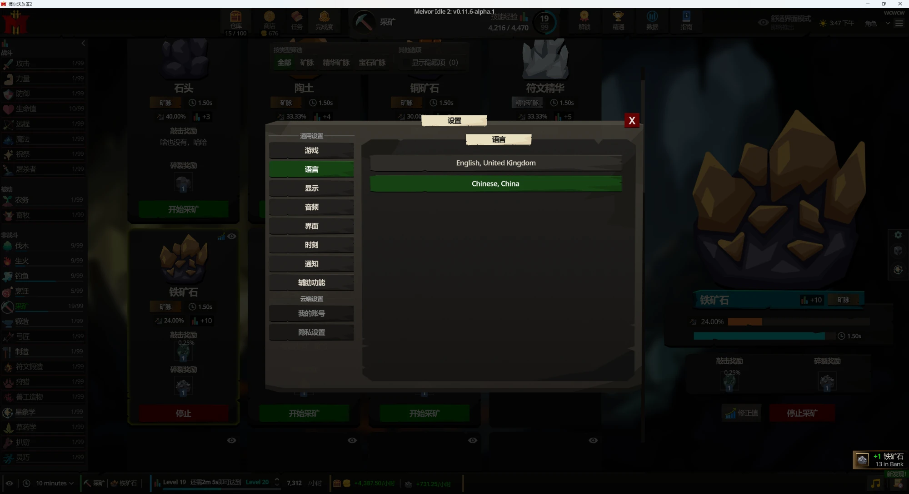

# Melvor Idle 2 简体中文补丁

[English](#english)

> ⚠️ **本项目不包含任何游戏文件。你需要在 Steam 上购买并安装 [Melvor Idle 2](https://store.steampowered.com/search/?term=Melvor%20Idle%202)。请支持正版，支持开发者。**
>
> 本项目是玩家社区的非官方作品，与 Games by Malcs、Jagex 没有任何关联。

## 致开发者

做这个项目，只是因为我们等不及想玩中文版的 Melvor Idle 2。感谢你们做出这么好的游戏，也感谢你们已经在准备中文翻译。

- **欢迎在未来的官方更新中直接采用这些修正。**`translation/` 中的内容均以 CC0 发布，无需署名或授权。如果需要附带修改理由的完整清单，请随时联系。
- **如果你们不希望这个项目存在**（例如因为它启用了尚未发布的草稿），请[提 Issue](../../issues) 联系我，我会立即删除本仓库。

## 这是什么

Melvor Idle 2 的游戏文件里，其实已经带了一份官方还没正式启用的简体中文翻译草稿。本项目做两件事：

1. **启用**这份官方草稿，让游戏的语言列表里出现中文；
2. 在草稿基础上**补全和校对**：
   - 补全 1872 条缺失条目。大部分是物品名的复数形式，缺了它们，日志和掉落提示里会显示英文。
   - 对照英文原文逐条检查了全部 10407 条文本，修正 354 处：错译、错别字、漏译、术语不统一、换行格式错误等。
   - 部分译名（祝祭、法术等）与一代 Melvor Idle 的官方中文保持一致。

翻译主体仍然是官方草稿，本仓库只保存**修正和补充的部分**（`translation/`），安装时脚本从你自己的游戏里读取官方草稿，在本地合并后写回游戏。



## 安装

1. 安装 [Python 3.8+](https://www.python.org/downloads/)（安装时勾选 “Add Python to PATH”）。
2. 下载本仓库（右上角 **Code → Download ZIP** 并解压，或 `git clone`）。
3. **关闭游戏**，在仓库文件夹里打开终端，运行：

   ```
   python melvor2_zh.py install
   ```

   脚本会通过 Steam 库自动查找游戏。如果找不到，把游戏目录作为参数传入：

   ```
   python melvor2_zh.py install "D:\SteamLibrary\steamapps\common\Melvor Idle 2"
   ```

4. 启动游戏，打开 **设置 → 语言（Language）**，选择 **Chinese, China**。

其他命令：

| 命令 | 作用 |
|---|---|
| `python melvor2_zh.py status` | 查看当前是否已安装 |
| `python melvor2_zh.py restore` | 卸载：还原官方原始草稿，删除 `override.cfg` |
| `python melvor2_zh.py build` | 只生成合并后的翻译文件到 `_work/zh_CN.po`，不改动游戏 |

## 注意事项

- **游戏更新后中文会消失**：Steam 更新或「验证游戏文件完整性」会还原 `Melvor2.exe`，关闭游戏后重新运行 `install` 即可。
- 如果更新后部分修正提示“未匹配”，说明官方改动了对应的英文原文，这些条目会保留官方译文，其余修正照常生效。
- 本补丁会直接修改 `Melvor2.exe` 内的翻译文件，exe 的数字签名会因此失效，但不影响运行；原始数据备份在 `_backup/`。
- 想彻底还原，在 Steam 里对游戏「验证游戏文件完整性」即可。
- 官方草稿尚未完成，个别文本可能仍是英文或有不准确之处，欢迎反馈。

## 已知问题（需要开发者修复）

以下界面的文字在翻译文件里**已经有中文**，但游戏显示时没有调用翻译，所以仍是英文。补丁无法修复，已反馈给开发者：

- 商店物品的描述（如「Upgrades the Fire Pit for Firemaking to Iron」）
- 星象学面板的「+1.00 per Study」「Next unlock at 12 Knowledge」
- 获得物品提示里的「13 in Bank」、底栏等级进度里的「Level」
- 底栏时间下拉框的「10 minutes」（翻译文件里没有这条）

## 参与修正

所有修正都在 `translation/overrides.json`，每条格式如下：

```json
{"ctxt": "", "en": "英文原文（必须与游戏完全一致）", "zh": "修正后的译文", "reason": "修改理由", "reason_en": "英文版修改理由"}
```

- 占位符（`{Value}`、`[Player Name]` 等）、BBCode 标签（`[b]`、`[color=...]`）和 `\n` 的数量必须与英文一致。
- 术语以官方草稿已有的译法为准，同系列名称保持统一。
- 欢迎提交 Issue 或 Pull Request。

## 许可

本仓库中的**原创内容**（脚本和 `translation/` 中的修正与补充）以 [CC0 1.0](LICENSE) 发布，任何人（包括游戏开发者）都可以自由使用。

游戏本身、英文原文及官方中文草稿的版权归 Games by Malcs / Jagex 所有，不在本许可范围内，本仓库也不分发这些内容。

---

<a id="english"></a>

# Melvor Idle 2 Simplified Chinese Patch

> ⚠️ **This project contains no game files. You must own and install Melvor Idle 2 on Steam. Please support the developers.**
>
> This is an unofficial community project and is not affiliated with Games by Malcs or Jagex.

## A note to the developers

This project exists only because we couldn't wait to play Melvor Idle 2 in Chinese. Thank you for making such a great game, and for already working on a Chinese translation.

- **Feel free to use any of these corrections** in a future official update. Everything in `translation/` is released under CC0, so no credit or permission is needed. If a full list with the reason for each change would help, just ask.
- **If you would prefer this project not to exist** (for example, because it enables an unreleased draft), please [open an issue](../../issues) and I will take the repository down right away, no questions asked.

## What it does

The game already ships an unreleased official Simplified Chinese (`zh_CN.po`) draft. This project:

1. **enables** that draft so Chinese appears in the game's language list, and
2. **completes and proofreads** it:
   - adds 1,872 missing entries (mostly `PluralName`-context item names, without which logs and drop messages show English);
   - checks all 10,407 strings against the English source and fixes 354 issues (mistranslations, typos, missing information, inconsistent terminology, broken line breaks);
   - aligns some names (prayers, spells) with Melvor Idle 1's official Chinese.

The bulk of the translation is still the official draft. This repository only holds the **corrections and additions** (`translation/`). At install time the script reads the draft from your own game files, merges the changes locally, and writes the result back into the game.


## Install

1. Install [Python 3.8+](https://www.python.org/downloads/).
2. Download this repository (**Code → Download ZIP**, or `git clone`).
3. **Close the game**, open a terminal in the repository folder, and run:

   ```
   python melvor2_zh.py install
   ```

   The game is located through your Steam libraries. If it is not found, pass the game folder:
   `python melvor2_zh.py install "D:\SteamLibrary\steamapps\common\Melvor Idle 2"`

4. Start the game, open **Settings → Language** and choose **Chinese, China**.

Other commands: `status` (show state), `restore` (uninstall: put the original draft back and remove `override.cfg`), `build` (only write the merged file to `_work/zh_CN.po`).

## Notes

- A Steam update or "Verify integrity of game files" restores `Melvor2.exe`; just run `install` again (with the game closed).
- Corrections whose English text changed in an update are reported as unmatched and skipped; the rest still apply.
- The patch edits the translation file inside `Melvor2.exe`, which invalidates the exe's code signature (the game still runs). The original data is backed up in `_backup/`.

## Known issues (need a fix from the developers)

The following UI text already has a Chinese translation in the game's translation file, but the game does not pass it through translation, so it stays in English. A patch cannot fix these:

- Shop item descriptions (`ShopPurchase.Description`, e.g. "Upgrades the Fire Pit for Firemaking to Iron")
- Astrology panel: "+{0:N2} per Study", "Next unlock at {0} Knowledge"
- Item notification "{0:N0} in Bank"; "Level" in the bottom-bar level progress
- "10 minutes" in the bottom-bar time dropdown (not present in the translation file at all)

## Contributing

All corrections live in `translation/overrides.json` as `{"ctxt", "en", "zh", "reason", "reason_en"}`; `reason_en` is an English explanation of each change. Placeholders, BBCode tags and `\n` counts must match the English text. Issues and pull requests are welcome.

## License

The original content of this repository (the script and the corrections/additions in `translation/`) is released under [CC0 1.0](LICENSE), so anyone, including the developers, may use it freely.

The game, its English text and the official Chinese draft are © Games by Malcs / Jagex. They are not covered by this license and are not distributed here.
